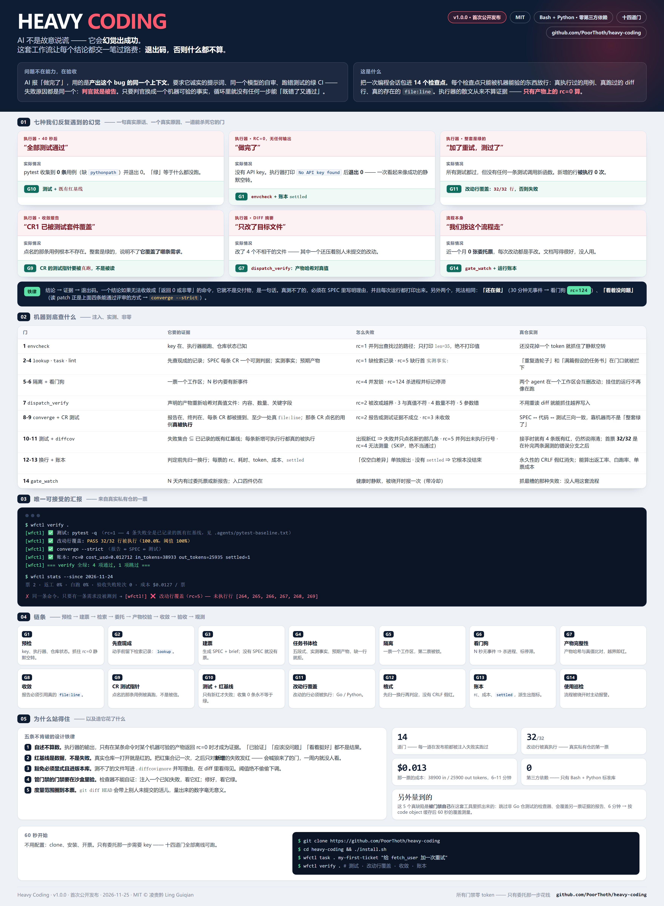

# Heavy Coding

[English](README.md) · **简体中文**

[](https://github.com/PoorThoth/heavy-coding/releases)
[](LICENSE)
[](docs/GATES.zh-CN.md)

> **当前版本 `1.0.0-beta.1` —— 首个公开测试版。** 这套工作流已经在日常开发里用了数月，这一版是第一次按「别人的机器」来打包。beta 期间命令名、参数与退出码仍可能变化。主测 Windows + Git-Bash；Linux/macOS 预期可用但未实机验证；Node 的改动行覆盖报 SKIP。变更见 [CHANGELOG.zh-CN.md](CHANGELOG.zh-CN.md)。

**给 AI 执行器上十四道闸的代码工作流 —— 每道闸只认退出码，不认自述。**



<sub>整图原件：[docs/diagram.zh-CN.png](docs/diagram.zh-CN.png) · 可编辑源码：[docs/poster.zh-CN.html](docs/poster.zh-CN.html) · 英文版：[docs/diagram.png](docs/diagram.png)</sub>

## 为什么需要它

AI 执行器说"做完了、测试全绿、已修复"，而仓库里根本不是这么回事。下面四种"看起来成功"的静默失效，全都骗过人：

| 失效 | 你看到的 | 实际发生了什么 |
|---|---|---|
| 凭据缺失 | `rc=0`，输出为空 | 执行器打印 `No API key found` 然后退出 0 |
| 测试压根没被收集 | `rc=0` | pytest 收集到 0 条用例；"绿"等于什么都没跑 |
| 测试通过但代码没被调用 | `rc=0` | 所有测试都过，没有任何测试调用新函数 |
| 报告与代码对不上 | `rc=0` | 收敛报告里的 `file:line` 根本不存在 |

每一种都由一道**大声失败**的门来堵：非零退出码、缺失的文件、没被执行的改动行。这就是全部思路 —— 没有需要信任的仪表盘，也没有可以"凭感觉"放行的地方。纯 Bash + Python，无框架、无服务、无厂商 SDK。

## 安装

需要：Bash（Linux / macOS / Windows 的 Git-Bash）、Python 3.9+。可选：Go、Node。

```bash
git clone https://github.com/PoorThoth/heavy-coding.git
cd heavy-coding
./install.sh            # 把 skills/ 与 scripts/ 拷进 $HC_HOME

export HC_HOME="$HOME/AppData/Local/hermes"   # 或 ~/.hermes
export HC_SCRIPTS="$HC_HOME/scripts"
export HC_LEDGER="$HC_HOME/run_ledger.jsonl"
bash $HC_HOME/skills/software-development/grill-then-implement/scripts/wfctl.sh envcheck
```

只有 `deleg`（委托那一步）需要 `DEEPSEEK_API_KEY`，写进 `$HC_HOME/.env`；其余门禁全部离线可用。`envcheck` 只报 key 的长度与来源，绝不打印值。

## 五分钟跑一票

```bash
cd /path/to/your-repo
WF=$HC_HOME/skills/software-development/grill-then-implement/scripts/wfctl.sh

bash $WF task . my-first-ticket "给 fetch_user 加一次重试"   # ① 生成 .agents/tasks/<slug>/
$EDITOR .agents/tasks/my-first-ticket/SPEC.md               # ② 写 CR1..CRn，每条带 [test: 文件::用例]
bash $WF lookup . "别人怎么解这个" --slug my-first-ticket --search   # ③ 真检索并留档
bash $WF deleg . .agents/tasks/my-first-ticket/brief.md     # ④ 交给执行器，读 rc
bash $WF converge . .agents/tasks/my-first-ticket/SPEC.md --strict   # ⑤ 报告与代码是否真一致
bash $WF verify .                                            # ⑥ 测试 + 改动行覆盖 + 收敛 + 账本
```

真项目第一票之前，多做两步（强烈建议）：

```bash
bash $WF testbaseline . "pytest -q"                     # 钉既有红基线：以后只报新增失败
export WF_DIFFCOV_PATHS=src/mod.py,tests/test_mod.py    # 只测本票动过的文件
```

## 十四道门

全部判据与 rc 表：[`docs/GATES.md`](docs/GATES.md)；红基线流程：[`docs/BASELINE.md`](docs/BASELINE.md)。

| # | 门 | 它不信什么 |
|---|---|---|
| 1 | `wfctl envcheck` | 不信执行器有凭据（缺 key 时它会 rc=0 白跑） |
| 2 | `wfctl lookup` | 不信这活是从零开始的 —— 先查现成 |
| 3 | `wfctl task` | 不信"没有 SPEC 也能委托" |
| 4 | 任务书体检 | 不信任务描述是完整的（五段式 + 实测事实 + 预期产物） |
| 5 | `wfctl worktree` | 不信两票能共用一个工作区 |
| 6 | 停滞看门狗 | 不信"还在思考"是进展 |
| 7 | `dispatch_verify.py` | 不信执行器没动它不该动的东西 |
| 8 | `converge --strict` | 不信收敛报告自己的说法 |
| 9 | CR 测试指针 | 不信"整套测试绿了所以这条覆盖了" |
| 10 | 测试 + 既有红基线 | 不信红灯都是本票造成的（也不信绿灯真跑过测试） |
| 11 | 改动行覆盖 | 不信"测试跑过了"等于"你改的行跑过了" |
| 12 | 换行归一 | 不信 CRLF 噪音是格式问题 |
| 13 | 运行账本 | 不信一票结束了（rc / 成本 / `agent_settled`） |
| 14 | `gate_watch` | 不信这套流程还有人用 |

## 五条设计原则

1. **自述不算数。**执行器的输出只有在某条命令对某个机器可验的产物返回 rc=0 时，才算证据。
2. **红基线是数据，不是失败。**真项目一打开就是红的。先记录，再只对**新增**失败发红；否则门禁变成噪音，一周内就没人看。
3. **豁免必须显式、进版本库。**测不了的文件写进 `.diffcovignore` 并写理由 —— 在 diff 里看得见、可复查。绝不偷偷降阈值。
4. **改门禁必须在沙盒里验证。**检查器不能自证：注入一个已知失败，看它红；修好，看它绿。
5. **度量范围圈到本票。**`git diff HEAD` 会带上别人未提交的 WIP，量出来的数字毫无意义。

## 参与贡献

未 vouch 的作者的 PR 会被自动关闭（[`vouch`](https://github.com/mitchellh/vouch)）——那是入口处的反垃圾门，这个仓库里的十四道门是出口处的反垃圾门。先提一个好的 issue，维护者回 `vouch`，之后你的 PR 才进得来；新人的 issue 不受限。动手之前读 [CONTRIBUTING.zh-CN.md](CONTRIBUTING.zh-CN.md)。

## 文档（中英文对照）

每份文档都有中英两版：英文版是基础文件名，中文版是 `<名字>.zh-CN.md`，两个版本顶部互相切换。

| 主题 | English | 简体中文 |
|---|---|---|
| 每一道门、每一个 rc | [docs/GATES.md](docs/GATES.md) | [docs/GATES.zh-CN.md](docs/GATES.zh-CN.md) |
| 红基线流程 | [docs/BASELINE.md](docs/BASELINE.md) | [docs/BASELINE.zh-CN.md](docs/BASELINE.zh-CN.md) |
| 80 行 runbook（轻/重模式） | [skills/code-gate/SKILL.md](skills/code-gate/SKILL.md) | [skills/code-gate/SKILL.zh-CN.md](skills/code-gate/SKILL.zh-CN.md) |
| 重模式全链参考 | [skills/grill-then-implement/SKILL.md](skills/grill-then-implement/SKILL.md) | [skills/grill-then-implement/SKILL.zh-CN.md](skills/grill-then-implement/SKILL.zh-CN.md) |
| 沙盒：亲手弄红一次 | [examples/lab/README.md](examples/lab/README.md) | [examples/lab/README.zh-CN.md](examples/lab/README.zh-CN.md) |
| 一图流 | [docs/diagram.png](docs/diagram.png) | [docs/diagram.zh-CN.png](docs/diagram.zh-CN.png) |
| 变更日志 | [CHANGELOG.md](CHANGELOG.md) | [CHANGELOG.zh-CN.md](CHANGELOG.zh-CN.md) |
| 参与贡献 | [CONTRIBUTING.md](CONTRIBUTING.md) | [CONTRIBUTING.zh-CN.md](CONTRIBUTING.zh-CN.md) |

**票面模板跟语言开关走。** `wfctl task` 从 `templates/task/*.tpl` 生成票（默认中文）。设 `WF_TEMPLATE_LANG=en` 就改用 `*.md.en.tpl` 与 `preamble.en.txt`，英文使用者拿到的是英文 SPEC/brief/收敛报告；不认识的语言自动回落中文。

下面这些暂时只有中文（内部工作笔记，不是入口）：`templates/delegation-prompts.md`、`templates/large-task-decomposition.md`、`templates/harness/README.md`、`templates/acceptance-checklist.md`、`templates/grill-quality-gate.md`、`skills/code-gate/references/gate-adoption.md`。需要就说话，我翻。

## 这套工作流是怎么来的

这套项目，是我作为一个中国的个人 AI 代码编程者，在重度使用 DeepSeek 做日常开发、也做大型严格项目的过程中，一点点打磨出来的。

我接触 AI 编程很早，已经不知道这个项目的起点最开始是什么模样了——可能是一份 spec，也可能只是一份提示词模板。但我一直有个习惯：每隔一个月，就要优化一次自己的 AI 编程工作流，既吸收最新的东西，也把我自己在开发里真撞上的实战问题加进优化过程。久而久之，工作流最终变成了这样。当我回头观望的时候才发现，我已经走出了非常远，也得到了难以置信的结果。

随着我的成长，这套工作流主要在解决我 AI 编程里最重要的两个问题：一个是 **AI 的幻觉问题**——我相信我目前的这套流程已经几乎解决了大模型在 AI 编程中出现的幻觉；另一个是 **大型、超大型项目开发会遇到的安全与规范问题**。

我认为目前这套工作流在多 agent 方面、以及"保质提速"方面仍然有所欠缺，但我也会努力去优化。希望我个人的这套工作流，能对你的工作和个人开发有所帮助。

PS：我取名为 heavy。一个是很贴合这套工作流的重型化；二是我很喜欢《I Like It Heavy》里的两句歌词：*"Some like beautiful, perfect, and pretty"*、*"I see the good in the bad and the ugly"*。我认为这就是一个工程思维的人在开发中所做的事情，也是我开发的核心思想——**see the good in the bad and the ugly**。

## 仓库结构

```
skills/grill-then-implement/   重模式全链：建票、委托、收敛、账本
  scripts/wfctl.sh             唯一入口（task/lookup/deleg/converge/verify/…）
  scripts/task_scaffold.py     生成带 CR 测试指针的 SPEC + brief
  templates/task/              SPEC.md / brief.md / converge.md 骨架
skills/code-gate/SKILL.md      80 行 runbook：30 秒定轻/重模式
skills/subagent-dispatch/      执行器封装 + dispatch_verify.py（产物完整性）
scripts/converge_check.py      规格 ↔ 代码 ↔ 测试三向收敛
scripts/diffcov.py             改动行覆盖（Go coverprofile / Python settrace / Node）
scripts/covrunner.py           零依赖的行级覆盖测量
scripts/ledger_stats.py        从运行账本派生产出指标
scripts/gate_watch.py          巡检：流程 N 天没人用了
docs/GATES.md                  每一道门、每一个 rc、它抓什么
docs/BASELINE.md               红基线流程
examples/lab/                  最小沙盒：亲手把门禁弄红一次
```

## 状态

主要在 Windows + Git-Bash（MSYS）上对 Go、Python、Node 仓库验证；Bash 是 POSIX 风格、Python 只用标准库，Linux/macOS 预计可用但**未实机验证**。Issue 与 PR 都欢迎。

## 许可

MIT © 2026 凌贵黔 Ling Guiqian
